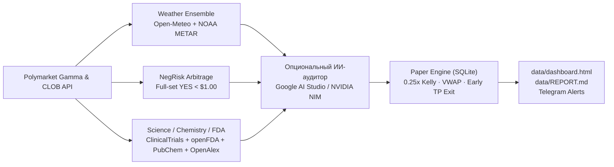

<div align="center">

# Polymarket High-EV Paper Trader

**Автономный paper-трейдер для Polymarket на чистом Python (0 внешних зависимостей)**

[](https://www.python.org/)
[](#)
[](.github/workflows/paper_trader.yml)
[](data/REPORT.md)

*Погодные ансамбли (Open-Meteo + METAR) · Структурный NegRisk-арбитраж · Наука / Химия / FDA · Реальный CLOB-стакан · Brier Score*

[Живой отчёт (`data/REPORT.md`)](data/REPORT.md) · [HTML-дашборд (`data/dashboard.html`)](data/dashboard.html) · [Быстрый старт](#-быстрый-старт)

</div>

---

## Зачем этот проект

Большинство «ИИ-трейдеров» на рынках предсказаний сливают депозит, потому что спрашивают у LLM «какая вероятность?» без внешних данных и считают бумажный PnL по средней цене.

Этот проект строит **честную количественную песочницу (paper trading)** с нулевым риском для капитала:
- **Исполнение по реальному стакану CLOB** (`best ask` / `best bid`, проход по уровням глубины VWAP, фильтр широкого спреда `> 8¢` и консервативное проскальзывание `+0.5¢`).
- **Критерий оценки — Brier Score против цены Polymarket**: пока бот не обыгрывает рынок на **50–100+ закрытых сделках**, реальные деньги заводить запрещено.
- **Работает 24/7 бесплатно** на GitHub Actions с автоматическим коммитом базы `data/paper_trader.db`, `data/REPORT.md` и `data/dashboard.html`.

---

## Архитектура



---

## Стратегии и источники данных

| Стратегия | Ниша | Источники данных (бесплатные) | Как ищет +EV |
|---|---|---|---|
| `weather_ensemble` | Ежедневная температура в 12 городах (NYC, London, Seoul и др.) | **Open-Meteo** (GFS + ECMWF + ICON) + **NOAA METAR** | Gaussian KDE по ~120 траекториям + обнуление невозможных корзин по реальному METAR в день экспирации |
| `negrisk_arb` | Взаимоисключающие события (`negRisk=True`) | **Polymarket CLOB** | Покупает полный набор `YES` по всем исходам, если сумма реальных `ask` строго ниже `$1.00 - margin` |
| `science_research` | Химия, биотех, FDA, клинические испытания, наука | **ClinicalTrials.gov**, **openFDA**, **PubChem**, **OpenAlex** | Собирает свежие факты + исторические base rates по фазам и калибрует LLM с байесовским сжатием к цене рынка |

---

## Ключевые функции

- **Честный симулятор стакана (`polymarket.py`)** — `simulate_buy_fill` и `simulate_sell_fill` с расчётом VWAP по реальным уровням глубины.
- **Досрочная фиксация прибыли (`check_early_exits`)** — если `best bid` на рынке перепрыгнул нашу справедливую вероятность (`model_prob + 3¢`) или достиг `96¢`, бот фиксирует прибыль досрочно.
- **Риск-менеджмент (`engine.py`)** — дробный критерий Келли (`0.25x Kelly`), лимит `5%` на сделку и `12%` на одно событие.
- **Визуальный дашборд (`dashboard.py`)** — автономный тёмный HTML-дашборд с KPI, SVG-кривой капитала, разбивкой по стратегиям и таблицей сделок.
- **Telegram-уведомления (`notifier.py`)** — мгновенные алерты об открытых и закрытых сделках (опционально).
- **Интерактивное меню (`run.py`)** — запуск без запоминания флагов, плюс мастер настройки `.env`.

---

## Быстрый старт

```powershell
cd "C:\Users\kusma\Desktop\antigravity\полимаркет"
uv run --no-project python run.py
```

### Основные команды CLI

| Команда | Что делает |
|---|---|
| `python run.py` | Интерактивное меню (рекомендуется для старта) |
| `python run.py run` | Полный цикл: резолвы + take-profit + скан всех 3 ниш + отчёт + дашборд |
| `python run.py science` | Показать активные научные/химические/FDA рынки + выжимку из баз |
| `python run.py dashboard` | Сгенерировать и открыть `data/dashboard.html` в браузере |
| `python run.py trades` | Список открытых и закрытых бумажных сделок |
| `python run.py setup` | Мастер создания `.env` (ключи Gemini, NVIDIA NIM, Telegram) |
| `python run.py demo` | Офлайн-симуляция полного цикла без интернета |

---

## Настройка 24/7 автозапуска на GitHub Actions

1. Загрузите репозиторий на GitHub.
2. *(Опционально)* В **Settings → Secrets and variables → Actions** добавьте нужные секреты:
   - `GEMINI_API_KEY` — бесплатный ключ [Google AI Studio](https://aistudio.google.com/apikey)
   - `NVIDIA_API_KEY` — бесплатный ключ [NVIDIA NIM](https://build.nvidia.com/)
   - `TELEGRAM_BOT_TOKEN` и `TELEGRAM_CHAT_ID` — для алертов в Telegram
3. В разделе **Actions** разрешите workflow **Polymarket Paper Trader** (и при желании включите Read and write permissions в **Settings → Actions → General → Workflow permissions**).
4. Бот будет автоматически запускаться каждые 5 минут, обновлять `data/paper_trader.db`, `data/REPORT.md` и `data/dashboard.html`.
